

  

  

 

  &nbsp;
  &nbsp;
  

 

## About Me

I'm an **AV & Software Engineer** in **Chicago, IL**. By day I'm the **Senior Executive Desktop Support Engineer** at **The Aspen Group (TAG)**, where I lead the company's enterprise AV modernization on Q-SYS, Crestron, Biamp and Shure and support the C-suite directly. Before TAG I worked AV at **Discover**, **Abbott**, **Kirkland & Ellis** and **Loyola University Chicago**, where I earned a B.S. in Computer Science with a minor in Philosophy.

Outside of work I build software: an encrypted habit tracker, a budgeting tool that never leaves your browser, an IT asset console that's in daily use, and a few more ideas on the way. I am always willing to try new things and work with anyone and everyone.

 

## 🎵 Now Playing

<!-- LASTFM:START -->

🎵 Recently Played

[**Which Side Are You On**](https://www.last.fm/music/The+Weavers/_/Which+Side+Are+You+On) by *The Weavers*
<!-- LASTFM:END -->

 

  <picture>
    <source media="(prefers-color-scheme: dark)" srcset="./profile-3d-contrib/profile-night-green.svg" />
    <source media="(prefers-color-scheme: light)" srcset="./profile-3d-contrib/profile-green.svg" />
    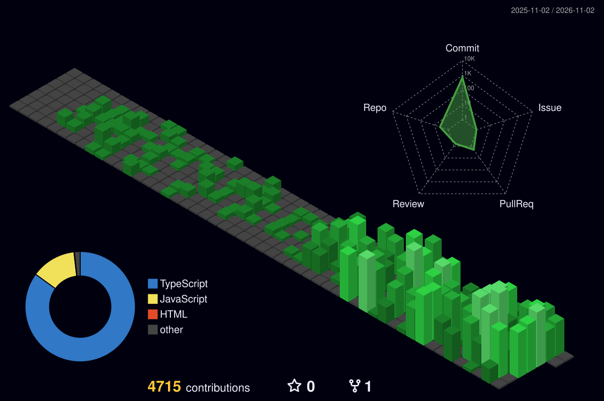
  </picture>

 

##  Cipher Tracker

> *"Master Your Habits. Secure Your Life."*

 

  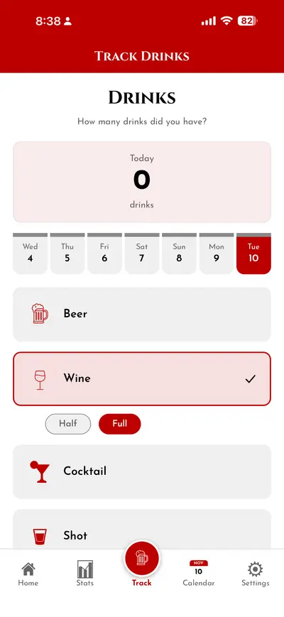&nbsp;&nbsp;
  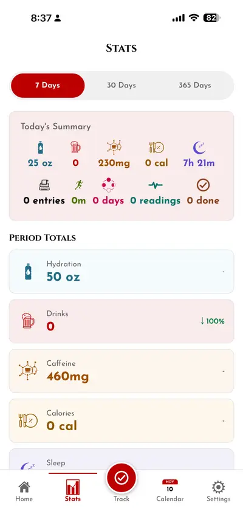&nbsp;&nbsp;
  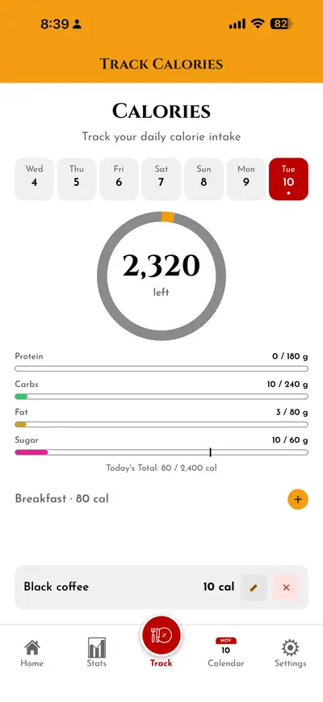&nbsp;&nbsp;
  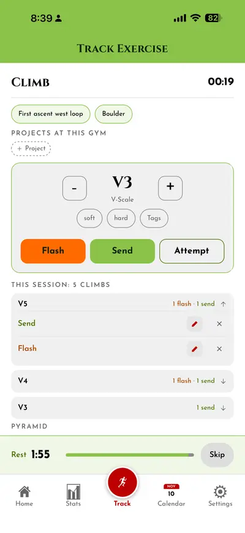

 

<b>More screens</b>

 

<h4 align="center">Addiction</h4>

  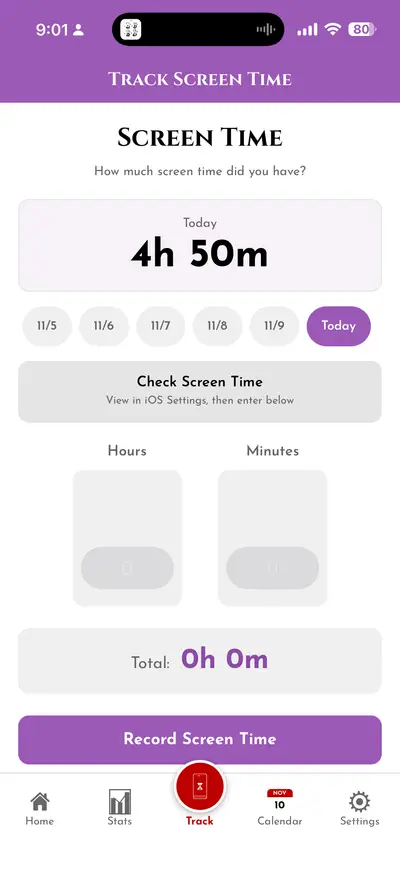&nbsp;
  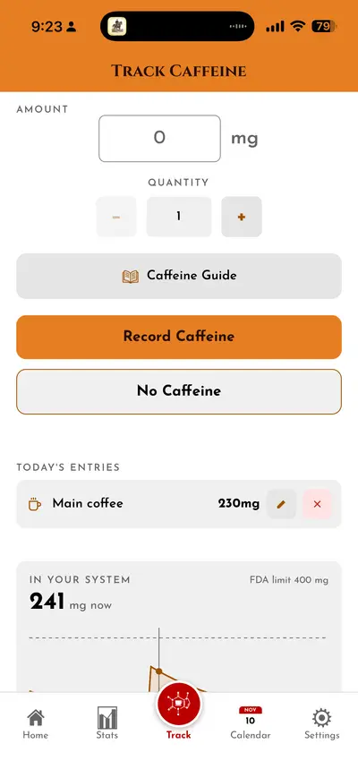&nbsp;
  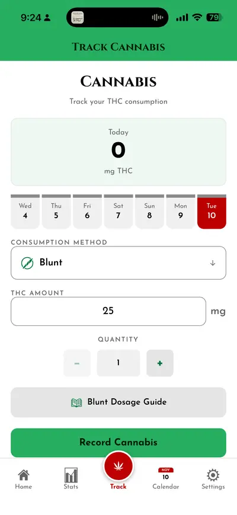&nbsp;
  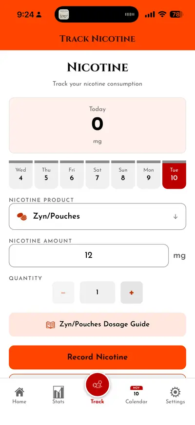

<h4 align="center">Health</h4>

  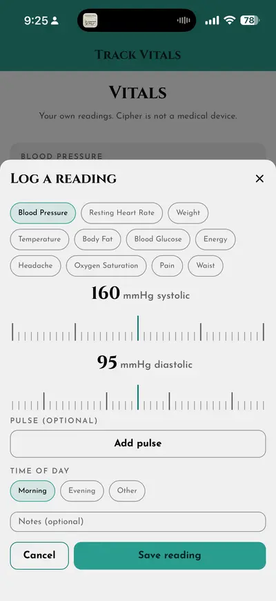&nbsp;
  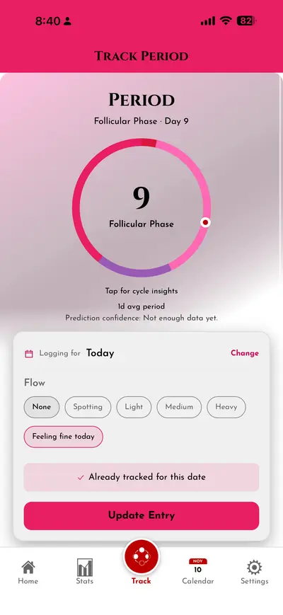&nbsp;
  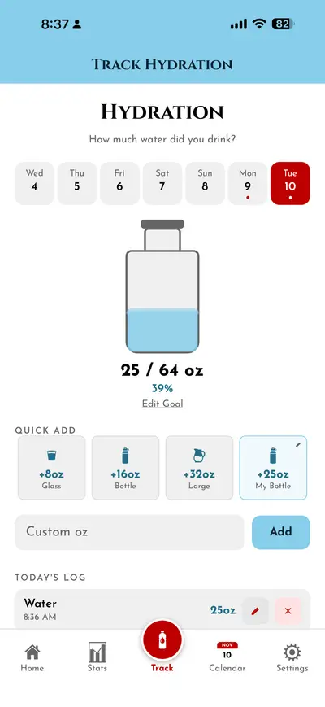

<h4 align="center">Wellness</h4>

  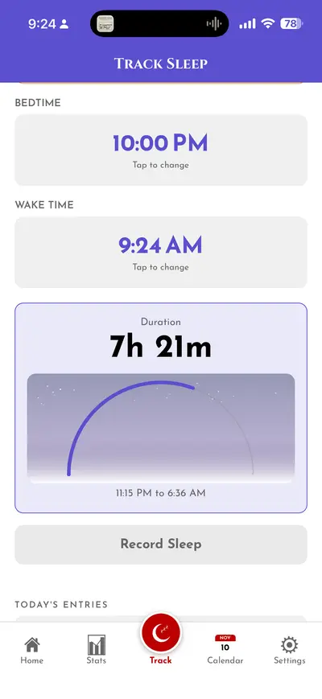&nbsp;
  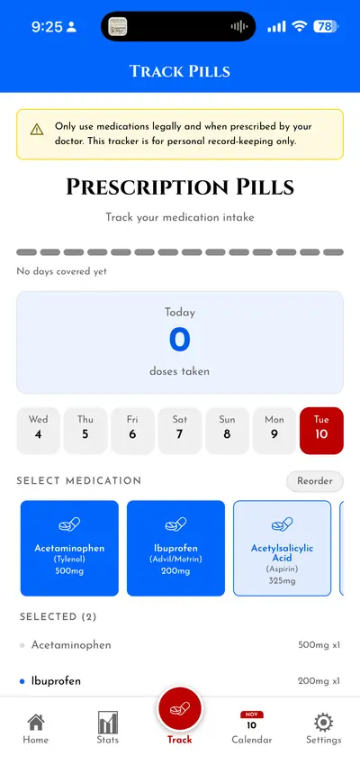&nbsp;
  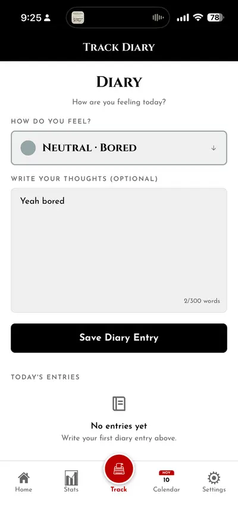&nbsp;
  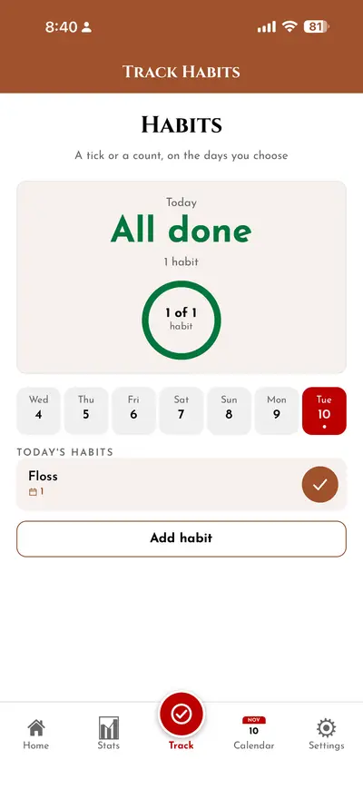

<h4 align="center">Stats</h4>

  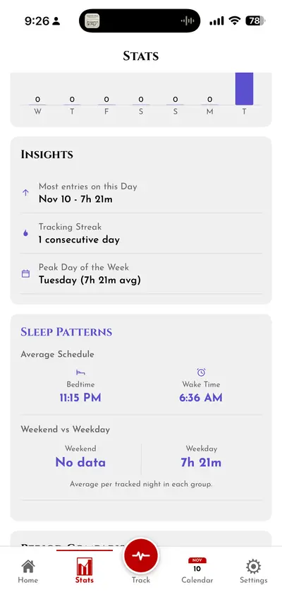&nbsp;
  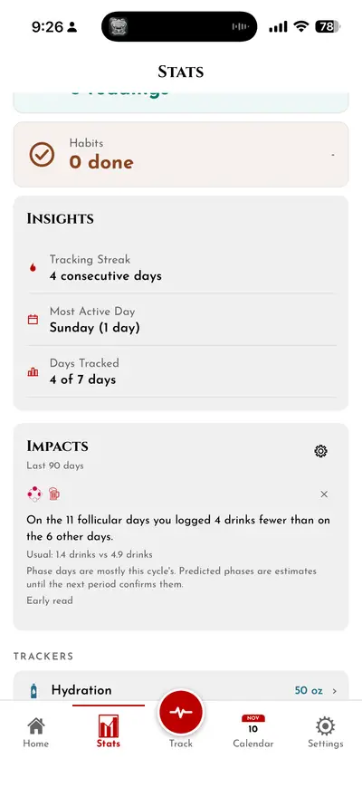&nbsp;
  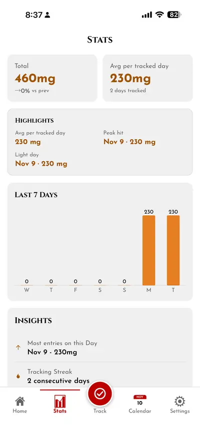&nbsp;
  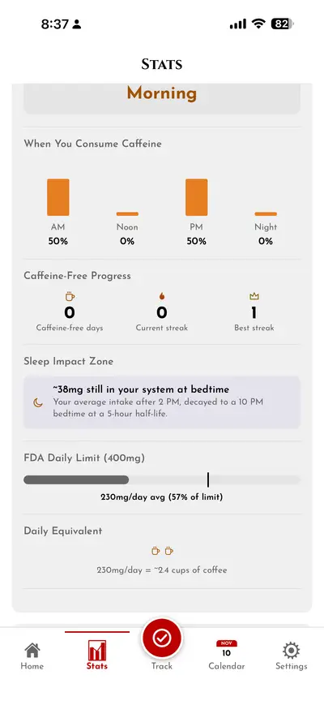

<h4 align="center">Privacy</h4>

  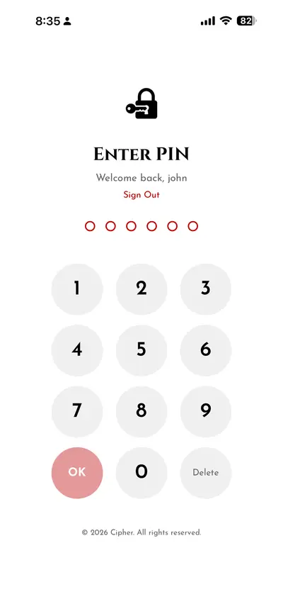&nbsp;
  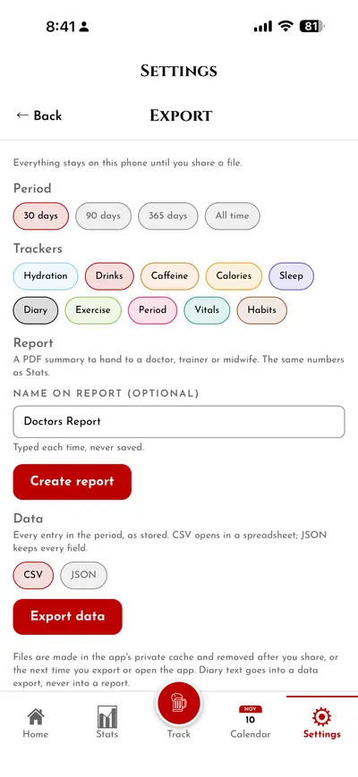

 

| | |
|:---|:---|
| **Platform** | iOS & Android, pre-launch. v1.5.7 is in App Store prep |
| **Stack** | React Native, Expo, Firebase (Firestore + Cloud Functions), RevenueCat |
| **Encryption** | AES-256-CTR on your phone, key derived with PBKDF2-HMAC-SHA256 (200,000 rounds), every write signed with HMAC-SHA256. The server only ever sees ciphertext |
| **Trackers** | Drinks, Caffeine, Cannabis, Nicotine, Screen Time, Sleep, Calories, Hydration, Pills, Period, Exercise, Vitals, Habits, Diary |
| **Features** | 877-exercise catalogue, barcode scanning, PDF health reports, CSV/JSON export |
| **Testing** | 3,822 unit tests |
| **Website** | Next.js 16, React 19, TypeScript, Canvas 2D |

 

  &nbsp;
  

 

## Projects

| Project | What it does | Stack | Status |
|:---|:---|:---|:---|
| [**Paper Trail**](https://papertrail.company/) | Upload your card statements and find out what you're paying for. Nothing leaves your browser | React 19, Vite, IndexedDB, Web Crypto | Live |
| [**Census**](https://www.johngeddes.org/Census) | An IT asset team's console: everything between someone asking for a laptop and it arriving, in one place | TypeScript, React 19, Express, Cloud Run, MySQL | In daily use |
| [**Chess Deck**](https://www.johngeddes.org/ChessDeck/play) | Every legal chess move, and twenty-one ways to break it | React, Vite, Firebase | Playable |
| [**Route Weather**](https://www.johngeddes.org/WeatherApp) | The weather along your route, hour by hour | | Live |
| [**Drink Horoscope**](https://www.johngeddes.org/DrinkDecider) | A cocktail paired to your zodiac reading | | Live |
| [**Rambler Registrar**](https://www.ramblerregistrar.com/) | Conflict-free class schedules for Loyola students | React Native, Expo, Firestore, Puppeteer | Pre-launch |
| [**Hike Away Tours**](https://www.johngeddes.org/HikeAwayTours) | Multi-day walking tours on US rail-trails, booked like a flight | Next.js, Expo, Firebase, Stripe | Pre-launch |
| [**GateKeep**](https://www.johngeddes.org/GateKeep) | Gig booking for one city's musicians, venues and fans | Expo, Next.js, Firebase, Stripe Connect | Planned |

 

 

## Tech Stack

<h4 align="center">Frontend</h4>

<h4 align="center">Backend & Tools</h4>

<h4 align="center">Cloud & Data</h4>

<h4 align="center">Security & Encryption</h4>

<h4 align="center">AV Systems</h4>

 

## GitHub Stats

  
  &nbsp;&nbsp;
  

 

  

 

  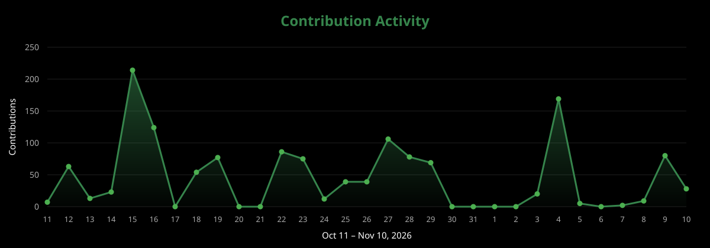

 

  <picture>
    <source media="(prefers-color-scheme: dark)" srcset="https://raw.githubusercontent.com/jgeddes3/jgeddes3/output/github-snake-dark.svg" />
    <source media="(prefers-color-scheme: light)" srcset="https://raw.githubusercontent.com/jgeddes3/jgeddes3/output/github-snake.svg" />
    
  </picture>

 

*"Privacy is not about having something to hide. Privacy is about having something to protect."*

 

  

